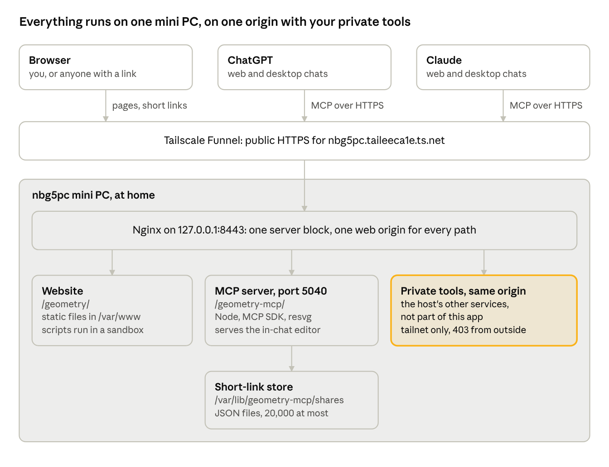
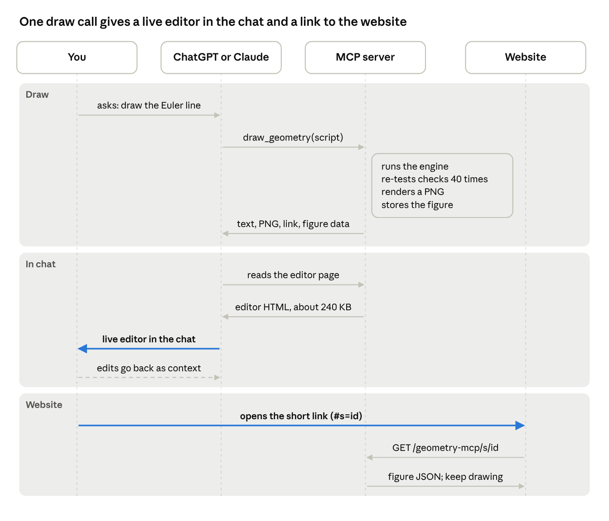
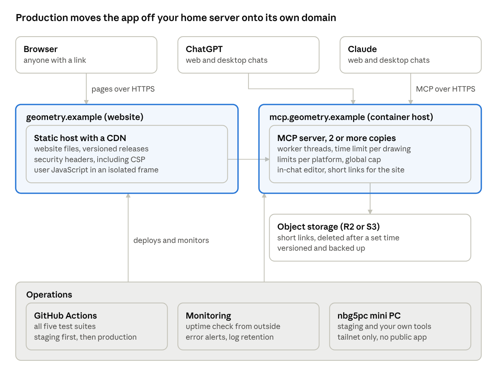
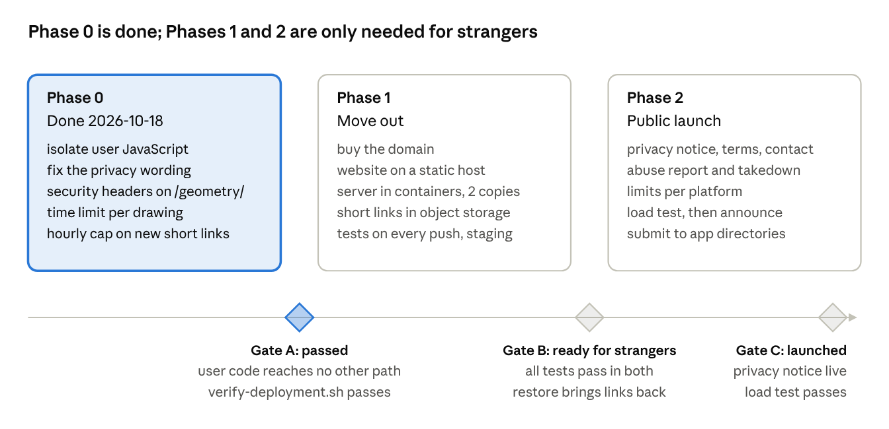

# Geometry Drawer: Architecture and Production Plan

As of 2026-10-18. This is the repository copy of the operator's private
Claude Docs doc of the same name, with details of the host's other services
left out because this repository is public. The diagrams are renders of the
doc's drawings, in `docs/img/`.

Geometry Drawer works well for you and the people you share links with, but it is not yet ready to be a public product. The code is in good shape; what must change is where it runs, what it shares a web address with, and how the short-link store is protected.

**Update, 2026-10-18:** Phase 0 of the plan is done and live, so sharing from this host is now safe. Phases 1 and 2 are still open and wait on the decisions at the end.

## Architecture today

Every public request enters through Tailscale Funnel and one Nginx server block, so the geometry app and your tailnet-only tools share one web origin; the `$from_tailnet` gate keeps outsiders out of the private paths, but code running inside the geometry page is not an outsider.

## What is built

The whole product is about 6,400 lines of plain JavaScript in one repository (`thanhan910/geometry-drawer`), with no build step for the website and five automated test suites run on every deploy.

| Component | What it does | Technology | Where it runs today |
| --- | --- | --- | --- |
| Website | The full editor: tools, algebra and script panels, olympiad commands, relation checker, theorem demos, Asymptote, TikZ and SVG export | Vanilla JavaScript modules, Canvas 2D, no dependencies | Static files in `/var/www/geometry`, public at `/geometry/` |
| Geometry engine | Expressions, dependency graph, intersections, conics, inversion, loci, triangle centres, the generality test | Shared JavaScript modules, used by both the website and the server | Browser and server |
| MCP server | Two tools for AI assistants: `geometry_language` and `draw_geometry` (script in; image, link, values, errors and checks out) | Node.js, official MCP SDK 1.32.1, resvg for PNG, zod | systemd service on port 5040, public at `/geometry-mcp/` |
| In-chat editor | The same editor, inlined into one 240 KB HTML page that chat apps show inside the conversation; edits flow back to the AI | MCP Apps (spec 2026-01-26) plus ChatGPT's older Apps SDK format | Served by the MCP server, shown in a sandboxed frame by ChatGPT or Claude |
| Short-link store | Keeps the figure behind each `#s=` link so AIs only copy 12 characters | One JSON file per figure, named by a hash of its content; at most 200 KB each and 20,000 in total, least recently used removed first | `/var/lib/geometry-mcp/shares` on the mini PC |
| Edge | TLS, public access, routing, throttling | Tailscale Funnel in front of Nginx; 60 MCP requests a minute per client address | The same mini PC (`nbg5pc`) that runs your private tools |

The tests cover 85 engine cases, a headless-browser smoke test of the website, the MCP protocol, the in-chat editor against a stand-in host, and the in-chat editor against the official MCP Apps host library.

## How a request flows

The chat app reads the editor page only when it refreshes its saved tool list, which is why ChatGPT showed a static image until the connector was re-created. The short link is the fallback that always works, in any chat app.

## Readiness

The application layer is close to production quality; the hosting and operations layer is a home lab. The table rates each area for a public launch to strangers.

| Area | Today | Ready for public launch? | What is missing |
| --- | --- | --- | --- |
| Engine and editor | Tested, dependency-free, fast | Yes | Nothing blocking |
| Untrusted content | Titles and captions shown as plain text, never HTML; size limits on every input; the page's content security policy blocks inline scripts, eval and outside connections | Yes | Nothing blocking |
| MCP protocol | Passes the official MCP Apps host test; works in Claude and ChatGPT | Mostly | Clients now try `server/discover` first and get a 400 from SDK 1.32.1, then fall back. Needs an upgrade routine |
| User JavaScript | Runs in a worker inside a sandboxed frame with an opaque origin and no network; stopped after 3 seconds | Yes | Nothing blocking |
| Hosting | One mini PC at home, behind Tailscale Funnel | No | Own domain, a host that is not your home, redundancy |
| Short-link store | Files on one disk; when full, the least recently used go first; new links capped at about 300 an hour per drawing worker | Partly | Expiry by age, backup, a way to delete |
| Capacity | One Node process with two drawing worker threads; each drawing stopped after 10 seconds; at most 8 waiting; about 78 MB in use | Fine for friends | More copies on more machines |
| Rate limiting | 60 requests a minute per client address | No | ChatGPT and Claude call from their own servers, so all their users share one bucket |
| Deploys | A script runs all tests, then copies files and restarts | Partly | Tests on GitHub for every push, versioned releases, one-step rollback |
| Monitoring | `verify-deployment.sh` on demand, journal logs | No | Outside uptime check, error alerts, log retention policy |
| Legal and privacy | The help page states what is stored and what logs record; no privacy notice yet | No | Privacy notice, terms, contact address |

## Security and privacy

The most serious remaining risk is that the public service runs on the same machine as your private services. Phase 0 removed the risk of user JavaScript reaching your private tools. Rows are ordered most serious first.

| Risk | Severity | Status | How it could happen | Fix |
| --- | --- | --- | --- | --- |
| Same machine as private services | High | Open | A flaw in the public Node service would run on the box that runs your private services. The systemd hardening (read-only home, read-only system, own state folder) limits but does not remove this | Move the public service off the mini PC (Phase 1) |
| Short links as free anonymous hosting | Medium | Open | Anyone can store a title, a 1,500 character caption and text objects under your domain, then share that link for spam or phishing | Abuse report link on the title card, takedown by id, expiry (Phase 2) |
| Rate limit by client address | Medium | Open | ChatGPT and Claude call from their own servers, so every ChatGPT user shares one 60 a minute bucket: too tight for real use, too loose against abuse | Limit per platform plus a global concurrency cap (Phase 2) |
| Shared origin with private tools | Low | Reduced | Was high: Script panel JavaScript ran on the same origin as the host's tailnet-only services, and could read them. Now it runs in `sandbox.html` with an opaque origin and no network, and the page's policy blocks inline scripts and workers. What remains: a bug in the page itself would still run on this origin | Done in Phase 0; own domain in Phase 1 removes the rest |
| Short-link eviction | Low | Reduced | Was: oldest removed first, so a spammer could push out every link in hours. Now the least recently used go first, opening a link keeps it, and new links are capped at about 300 an hour per worker (two workers), so a flood of 20,000 takes over 30 hours and spares any link opened meanwhile | Done in Phase 0; expiry by age in Phase 1 |
| One heavy drawing blocks everyone | Low | Fixed | Was: drawings ran on the main thread with no time limit. Now each runs in one of two worker threads and is stopped after 10 seconds; the main thread stays free | Done in Phase 0 |
| Wrong privacy statement | Low | Fixed | The help page said nothing is stored. It now says what is kept (the figure behind each short link) and what logs record | Done in Phase 0; a full privacy notice in Phase 2 |
| Request logs | Low | Open | Nginx logs client addresses; the service logs client name and method names, never scripts | State the retention in the privacy notice and rotate on a schedule |
| Content-addressed ids | Low | Accepted | Someone who already has a figure's exact content can compute its id and confirm it is stored. Ids are about 62 bits, so guessing is not practical | Accepted; say that links are unlisted, not secret |

What is stored per short link: the figure's objects, view, settings, title and caption. Nothing identifies the person who made it, and there are no accounts. Keeping it that way is the cheapest privacy position: avoid sign-in for as long as possible.

## Target architecture

The app gets its own domain, so nothing it runs can reach your private tools, and the mini PC goes back to being private. `geometry.example` stands for whatever name you choose. The engine and editor code do not change; only hosting, the short-link store and the server's request handling do.

| Choice | Recommended | Alternative | Approximate cost |
| --- | --- | --- | --- |
| Domain | Any registrar | A subdomain of a domain you own | About US$10 to 15 a year |
| Website host | Cloudflare Pages | GitHub Pages, Netlify | Free tier is enough |
| MCP server host | Fly.io or Google Cloud Run (container, scales to more copies) | A small virtual server you patch yourself | A few dollars a month at low use |
| Short-link store | Cloudflare R2 with a lifecycle rule | S3, or SQLite on the server with nightly backups | Free tier is enough at this size |
| Monitoring | An external uptime checker plus alerts to email | Self-hosted on a separate machine | Free tier is enough |

Costs are rough figures from memory, not quotes; check current pricing before choosing.

## Plan

Phase 0 was done and deployed on 2026-10-18: all five test suites pass, and the live site was checked in a headless browser. Phases 1 and 2 matter only if the app is for people you do not know.

### Phase 0: make this host safe

- [x] Script panel JavaScript runs in `sandbox.html`, framed with `sandbox="allow-scripts"`, whose policy blocks all network access; a browser test checks that a script cannot make a request
- [x] Corrected "nothing is stored" on the MCP help page and in the code comments; the help page now says what is kept and what logs record
- [x] Added a content security policy to the page, and security headers to `/geometry/` and `/geometry-mcp/`
- [x] Each drawing runs in one of two worker threads and is stopped after 10 seconds, with at most 8 waiting
- [x] Capped new short links at about 300 an hour per worker (in the server, not Nginx, since one endpoint serves every MCP call), and pruning now removes the least recently opened links first

### Phase 1: move out

- [ ] Buy the domain and decide the two hostnames
- [ ] Publish the website to the static host from GitHub, with versioned releases
- [ ] Package the MCP server as a container and run two copies on the container host
- [ ] Move short links to object storage with an expiry rule, keeping the 12-character ids; let the old `nbg5pc` links redirect for a while
- [ ] Run all five test suites on every push; deploy to staging, then to production
- [ ] Add an outside uptime check, error alerts and a log retention setting
- [ ] Remove `/geometry/` and `/geometry-mcp/` from the mini PC's public routes, then update the workspace exposure table and `verify-deployment.sh`

### Phase 2: public launch

- [ ] Publish a privacy notice (what is stored, for how long, logs), terms and a contact address
- [ ] Add a report link to the title card of shared figures, and a takedown command
- [ ] Replace per-address limits with per-platform limits and a global concurrency cap
- [ ] Upgrade the MCP SDK so `server/discover` stops returning 400, and set a monthly dependency review
- [ ] Version the tool definitions and keep a separate staging connector, since chat apps cache them
- [ ] Load test at the rate you expect, then submit to the ChatGPT and Claude app directories

## Open decisions for you

- [ ] Who is it for: you and friends, IMO students you teach, or anyone on the internet? Phase 0 is enough for the first; the second and third need Phases 1 and 2.
- [ ] Which domain name, and in which country you publish the privacy notice (it sets which privacy law applies).
- [ ] Short-link lifetime: a fixed term such as one year since last opened, or kept for ever with a hard size budget.
- [ ] Hosting choice for the server: a managed container platform (less to run) or a small virtual server (cheaper, more to maintain).
- [ ] Whether to list it in the ChatGPT and Claude app directories, which brings a review and their policy requirements.
- [ ] Whether sign-in is ever needed (saved galleries, classes). Avoid it unless a feature truly requires it.
